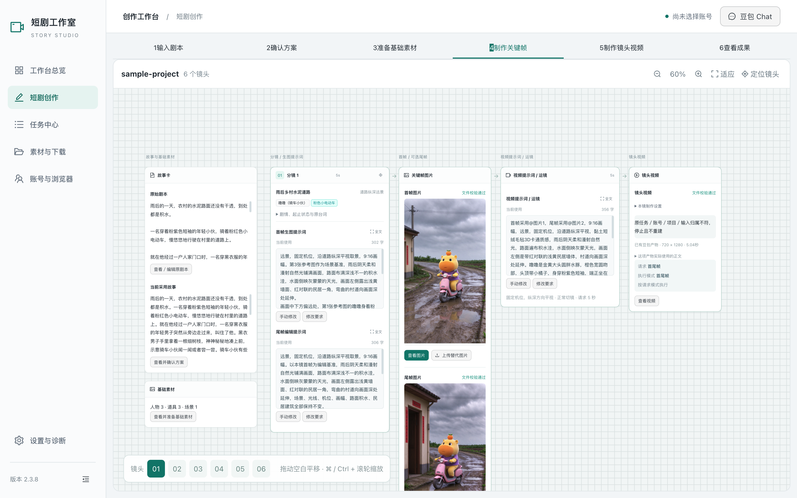
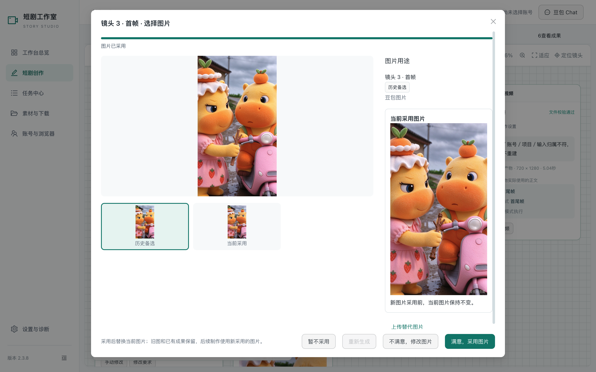
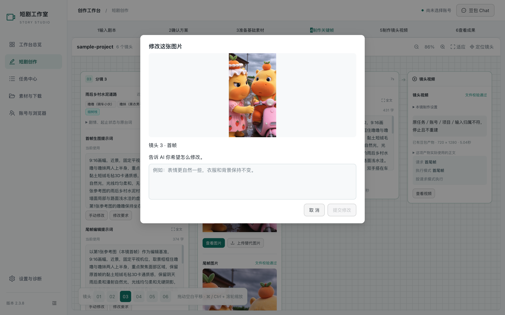
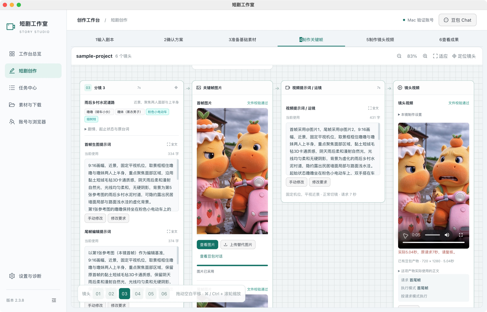

# 本轮真实产品走查与设计依据

2026-11-02。目标：让短剧创作围绕作品、角色、镜头及创作决定组织。结论：**现有空间画布骨架与媒体适合保留；重复动作和执行状态需要收拢。** 本轮只取证和交接。动作点击后回读界面，截图保存并视觉检查；不是生成链验收或完整无障碍审计。

## 步骤、事实与健康度

| 步骤 | 实际操作与状态 | 健康度／限制 | 本轮截图 |
| --- | --- | --- | --- |
| 1 | 现有原生 Electron 实窗：ui-project，5 镜、3 人物、1 场景，素材 7/7 | 可访问；首页仍有待处理事项和多处任务进展，须按新规则撤去常驻面板 | `00-current-window.png` |
| 2 | 从用户已有 6 镜项目复制 JSON 与38媒体；隔离 Electron 的原 Open 按钮读取副本 | 可读取；不复制账号／任务／Session，不发生成 | `capture-environment.json`、`data-provenance.json` |
| 3 | 画布切 sh03、定位；缩小两次、空白拖动平移，回首镜显示故事与素材列；两尺寸保留全部 6 镜导航 | 骨架正常；原场景焦点时左故事列在屏外属平移结果；1280保留视角后故事左边被裁，需平移，不能宣称自动适应完美 | `12-canvas-sh03-1440.png`、`19-canvas-detail-1280.png`、`32-canvas-skeleton-1440.png`、`33-canvas-skeleton-1280.png` |
| 4 | 打开 sh03 视频提示词完整正文，再返回画布 | 可读，431字真实正文完整；当前无新文字候选，未点击确认使用 | `13-prompt-full-1440.png`、`34-prompt-full-1280.png` |
| 5 | 进入方案与基础素材页，查看已采用方案与真实 7 张基础图 | 可访问；方案保留生成记录／诊断，标题有更多；是待删除现状；没有重新确认方案 | `24/25-plan-*`、`26/27-materials-*` |
| 6 | 预览 sh03 正式首帧；选择“历史图片1”查看，与当前采用图对照 | 可用，历史选图显示采用按钮；没有点击采用，原图未变；历史候选已收束，不算当前待处理 | `14-image-review-1440.png`、`15-image-history-review-1440.png`、`18-image-review-1280.png` |
| 7 | 历史选图→不满意，修改图片→反馈窗；两个尺寸检查→取消回预览 | 可用；基图明确，空输入提交禁用；没有输入或提交，未调用修改任务 | `16-image-feedback-1440.png`、`17-image-feedback-1280.png` |
| 8 | 隔离视频页读取报原任务归属缺失；原实例正常打开副本后切 sh03，播放器从0:00播至0:05 | **原实例真实播放通过**；本镜时长不符仍需复核；隔离读取错误不能归因为生产文件失败；镜2 AX曾报告无法播放，本轮没有进一步验证该镜 | `20-video-preview-1280.png`（环境限制）、`40-native-canvas-sh03.png`、`41-native-video-playback.png` |
| 9 | 打开逐镜成果，查看当前关键帧、视频保存／校验及人工质量状态 | 可访问；多层统计和“继续缺失项”重复状态；质量确认仍跨任务页，不能用文件校验替代人工质量 | `22-results-1280.png`、`23-results-1440.png` |
| 10 | 查看账号与浏览器：隔离账号空态；原实例实际1账号和正常平台页 | 原实例可访问；仅本地证据包含私人昵称／会话标题；未新增账号、登录或操作平台输入 | `28/29-accounts-*`（只证明空态）、`42-native-accounts.png`（禁止上传） |
| 11 | 查看设置页，两个尺寸检查偏好／数据／运行检查／诊断 | 可访问；“诊断详情”仍常驻，与新要求冲突，移出面向创作用户主流程；未改变设置 | `30-settings-1280.png`、`31-settings-1440.png` |
| 12 | 原实例重新打开 ui-project 回到素材页；关闭隔离实例和临时 Browser | 完成；正式源码无diff、原项目哈希未变；只新增交接目录 | `working-tree-check.json`、`screenshot-manifest.json` |

## 从截图得出的设计取舍

1. **节点的作品层次要强于执行信息。** 12、19、40中，同一视频节点重复标题、文件校验、执行模式、请求模式、任务状态；图片又有采用标签及完成进度条。保留当前作品／候选／历史／真实失败差别，合并同一事实的多处标签；不能把不同事实合成一个假“完成”。
2. **默认自然语言反馈，直接编辑按需进入全文。** 13中“手动修改”“修改要求”并列；源码证实前者直接保存 final，后者生成完整新候选，不能只改成同一回调或删除保存语义。进入全文后再提供有独立价值的直接编辑。
3. **合并重复定位和播放。** 12/19/32中比例、适应、定位都调用 `focus(activeShot)`；只有-/+是真缩放。保留比例读数和一次定位；不得把现状“适应”标成全图适应。40/41的浏览器播放器已有controls，另有“查看视频”，可统一播放入口。
4. **保留明确的图片决定权。** 15真实展示历史图与当前采用对照及“满意，采用图片”；16/17反馈绑定选图。新设计应保持图片大图、用途、当前／历史差别，不恢复基础提示词流程。
5. **减少跨应用往返。** 正常文字与图片回读在后台；原实例无需为播放进入豆包。方案主动自由调整当前仍需进入对应会话并选具体回复，是待接通能力，不能只藏旧路。真实登录／验证及受理未明按对象原位提示，不能常驻待处理面板。
6. **两尺寸的空间连续性需要精修。** 32/33保持网格与平移，缩小后可看到左故事与右镜头；窗口变窄仍保持中心，部分内容出屏，需要明确定位。新原型应减少外壳留白、重复标题和冗长技术摘要，保留媒体比例、全文阅读和全部镜头导航。

## 可见的可访问性风险

长文本预览、画布与页面有多种滚动范围；缩到60%后节点小字、按钮随场景缩放（32/33），只为全览，不能作为默认阅读尺寸。次要文字与网格对比偏弱（12/19），错误同时有文字，图片选中也有“历史／当前采用”文字。原型需保证键盘焦点、弹层焦点返回与缩放下可达按钮；本轮未做系统键盘／读屏／对比度测量，不能声称WCAG达标。

## 接线与证据限制

操作去留及七项差距见 `../upload/02_INTERACTION_MAP.md`，完整源码行号见 `source-map.md`；规则优先级见 `rules-current.md`。DPR与内容尺寸只以 `screenshot-manifest.json` 直接读回值为准；原生整窗未读回值保持未知。04–06上传图来自真实隔离 Electron，不是Browser模拟。Codex内置Browser缺preload的失败已记录，未用空白截图冒充审计。

当前样板无正在生成／实时新文字候选／验证／不明受理实例；独立 `../preview/design-states.json` 给出明确“设计模拟”投影，不制造任务或成功结果。未执行反馈提交、采用、生成、重发、质量确认或恢复，不拿源码存在冒充端到端通过。

## 本轮主要截图

真实 Electron 骨架，1440×900 内容区，DPR2、画布约60%；错误框来自隔离任务台账缺失。

真实历史图片预览，选择本身没有改变采用。

真实图片反馈弹窗，未提交。

原实例历史视频已播放到约0:05；原请求7秒差异保留。

