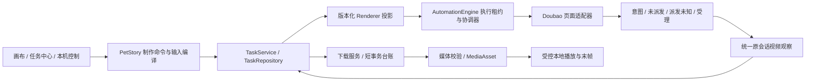

# 视频链路重构与验收

基线：9224e536d53b1c5527baf5e43ca7c622214c8982。工作分支：codex/video-workflow-refactor。开始时工作区干净。

## 实际入口与所有权

|事实|权威|其他位置的含义|
|---|---|---|
|输入与运行身份|Task.runtime.input / runId|制作 step 保存编译来源及关联，不另造可写运行|
|状态、提交与本地收取阶段|TaskService 命令，经 Repository 原子持久化|Store、账号忙碌、制作步骤为投影；localMedia 记录下载至入库的可恢复检查点|
|页面执行权|AutomationEngine 写入租约 + 运行/文档操作上下文；稳定宿主保存控制器与原观察 Promise|恢复只读观察不另开写入租约；浏览器可见性只控制展示|
|远端视频身份|原 run 的消息/卡片/vid 与 artifact|签名 URL 可刷新，不代表新视频|
|本地成果|MediaAsset 来源快照、hash 与文件|队列任务、远端有效期不是播放前置条件|
|跨文件绑定|可重入意图记录与稳定 operation/step/task 身份|重启恢复唯一关联，不换随机任务掩盖半写入|

## 实施清单

- [x] 核对基线、锁文件、项目规则，创建独立分支。
- [x] 建立并记录高价值行为 red 回归。
- [x] 输入快照与主进程运行身份、版本化回执。
- [x] 正式页面适配器、可取消操作、显式单次提交结果、统一观察。
- [x] 下载并发/超时/保存故障与媒体工具分类。
- [x] 本地资产独立播放、重新读取/下载/校验、新版本和结束制作。
- [x] 半写入兼容恢复与历史数据迁移。
- [x] 组合故障注入、完整 validate、真实本地媒体播放与诊断说明。
- [ ] 真实豆包生成到本地播放；现有原请求只返回文字，保留现场及明确重发入口。

## 基线证据

修改前类型检查通过；21 个相关文件的 539 项测试全部通过。高价值新行为回归先在现实现下确认失败，再修复：附件按钮误点、明确未派发被当成提交未知、不同卡片 vid 混用、旧 run/乱序快照、半写入绑定、下载交错覆盖/写失败/响应体停滞、工具故障误拒和任务删除后不能播放。基线通过不代表上述现场缺陷不存在。

## 新旧职责对应

|原路径|现在的正式路径|清理与保留理由|
|---|---|---|
|BrowserPanel 内的新任务与原请求恢复长流程|TaskExecutionCoordinator / TaskRecoveryCoordinator + TaskExecutionHostState + AutomationEngine|新建与恢复都移出页面组件；独立任务页沿用原账号 partition；恢复协调器消费类型化宿主，重挂载复用原观察 Promise、控制器与原请求；React 只安装/卸载事件桥并展示|
|正常视频空数组轮询、恢复单独解析|DoubaoVideoAdapter.observe → observeVideoArtifact → 原消息解析|统一观察算法，正常和恢复均保留选择/权限/过期/平台拒绝结果；恢复入口保留原会话导航与人工选择桥接|
|颜色/尺寸/相对位置最终发送兜底|输入区归属 + 精确控件身份/语义 + 单次派发联合结果|删除颜色猜测；“视频生成/图像生成/重新生成图片”技能控件不作为最终发送按钮|
|doubaoBridge.submitPrompt / submitVideoGeneration|SubmissionCoordinator → submitPromptOnce|删除无生产调用的旧提交器；删除禁用后不可达的 15 秒补丁；旧补丁接口只返回 false 兼容历史调用|
|独立自检规则包/回滚 UI|正式适配器只读 readComposer|移除仅影响自检、不影响执行的安装/回滚路径；旧持久字段只兼容读取|
|散落 eligibility/materials/promptQuality 互相运行时导入|videoInputCompiler + petstoryMaterialFacts + petstoryPromptReferences|资格包装 API 保留，素材事实与引用映射变成纯边界，运行时依赖环消除|
|桌面/制作/本机控制各自下载|DownloadService + DownloadRepository|删除跨 await 保存旧 jobs 整表和 arrayBuffer 视频下载；按原 run/artifact 复用 job|
|视频 base64 IPC、任务/远端有效性门槛|MediaAsset/sourceSnapshot + LocalMediaProtocol + DownloadedVideoPreview|视频播放走受控 Range 流，图片沿用原接口；原 Task 清理与 URL 过期不破坏本地成果|

`Task.status=done` 表示原平台产物已识别，不再伪称已入库；同一权威 runtime 的 `localMedia` 继续记录 downloading → downloaded → validating → library → ready。暂停、失败及入库检查点都经过 Core。项目 production/step 是用户授权与来源投影，不是另一套可独立改写的运行真相。

提交事实依次为 intent_saved、not_dispatched / dispatch_unknown、accepted。意图不填写受理时间；只有进入最终控件激活边界才记录可能派发。ACK 丢失观察原请求，不重新点生成。平台没有幂等键，因此不宣称远端 exactly-once。

媒体最终派发在正式探针预留唯一控件后，使用实时控件几何与 Electron 原生鼠标事件，并读取可信激活回执。预留 ACK 丢失而未调用原生输入时明确未派发；原生输入已尝试而 ACK 丢失时只观察原请求。取消墓碑阻断迟到事件，旧运行上下文不能借用新运行租约。独立 Electron webview 八项验收通过，不等于真实平台已经成功生成。

## 兼容与恢复

读入迁移集中在任务归一化和项目读入；无 revision 的旧任务补单调起点，旧已校验资产补最小来源快照。旧工具错误拒绝转入历史，恢复工具后对原文件重新校验。制作和正文任务共用稳定意图日志，项目/任务任一写点中断都按原身份复原，不批量清空记录。详见 [输入与事务迁移](../VIDEO_WORKFLOW_MIGRATION.md)、[媒体边界与原生播放证据](../VIDEO_MEDIA_PIPELINE.md)。

结束本次制作只结束本地执行与等待，保留平台提交事实及原请求入口；不会假装取消远端生成。新版本成功前保留旧视频；旧 run 的迟到产物只能归入原历史。

暂停命令立即撤回本地执行权，再接收权威持久化回执；单任务和批次都不会因保留了受理事实而自动恢复观察。当前画布视频节点可暂停或结束。历史图片制作按其冻结模式校验，与当前视频草稿分开；无关镜头的暂停不阻断本镜编辑，相关镜头仍须正式结束后修改。结束图片等待保留原任务、候选与文件。

## 验证证据与实机记录

领域层使用真实 TaskService/TaskRepository，覆盖原运行身份、单调 revision、终态保护、保存失败、事务四个关键写点及重启；适配器集成用受控 DOM/HTTP，覆盖三种模式、素材 SHA 和顺序、授权等待、一次最终激活、ACK 丢失、过期/权限/多卡片选择及取消后迟到动作。

本地闭环不是 play mock：`pnpm run verify:video-local` 创建真实五秒 MP4，通过正式下载、落盘、FFmpeg 完整解码、入库，删除原任务并关闭远端 fixture 后，再由真实 Electron video 元素 Range 播放与 seek。2026-11-10 最终成功证据见 `artifacts/mac/video-workflow-local/2026-11-10T03-32-29-247Z/evidence.json`（本机私有目录）：87,128 字节、5 秒，播放时间推进至 4.021602 秒、readyState=4、seek 完成、Range 返回 206。记录明确为 fixture，不是豆包成片。

真实平台验收使用现有 sh01 五秒镜头、原账号与已采用首帧。视频正文任务 `15d54fbb-2267-4783-b692-55716424d7ee` 和尾帧正文任务 `d8e1c921-5064-425b-aafd-f55a91d4b596` 均已受理、回读、确认使用；尾帧图片任务 `236b494e-b7f1-4f47-9a4c-607cf7772406` 只返回操作建议，没有真实图片，已结束本地等待并保留原请求。随后切换现有镜头为 first_frame，重新准备并采用正文任务 `91a511b3-9b64-4157-b052-c432ead63bfa`。视频任务 `aeffa5d8-8927-4941-9790-a54cc28b3cd5`、原 run `aeffa5d8-8927-4941-9790-a54cc28b3cd5-1794278728144` 核对 Seedance 2.0 Fast / 5s / 9:16 与真实首帧后提交，平台保存了原消息，但只返回可复制的视频提示词，没有视频卡或文件。

最终构建重启后，沿同一 run 执行“检查原视频结果”，统一观察器将原任务持久化为 paused / video_generation_not_started；没有新增平台请求。可信点击机制已在独立 webview 验收，但尚未经授权在原平台重发验证，不能认定它已解决此次纯文字结果的根因。现场记录为 `artifacts/video-workflow-platform-20261110/acceptance.json`，`platformVerified=false`。2026-11-10 用户明确选择“先不重发，只保留原结果”，并反馈电脑已解锁；本次不创建关联重发任务，不再等待重发授权。真实三模式、平台成片下载及播放保留为未验证项。

完整 `pnpm run validate` 已通过：252 个测试文件、4,807 项测试，类型、Lint、工程规则、契约与构建均通过；Lint 143 个警告、0 错误，未提高现有容限。最终日志位于 `artifacts/mac/video-workflow-final-20261110/validate-complete.log`。另有正式媒体原生派发 8/8 证据 `artifacts/mac/native-submission/verified-native-8-final/evidence.json`。19 个场景的具体覆盖与实机边界见 [验收证据](../VIDEO_WORKFLOW_ACCEPTANCE.md)。

## 启动与最少验收

依赖已安装时运行 `pnpm run dev:mac`；正常开发入口仍为 `pnpm run dev`。工具使用已有 ffmpeg/ffprobe；安装资源、PATH 和 macOS 常见目录统一解析，也可用 `DOUBAO_FFMPEG_PATH` / `DOUBAO_FFPROBE_PATH` 指向已有文件。缺工具只影响校验，不要求重新生成。

在原账号打开现有项目，选择完整输入镜头并点“生成视频”，核对其真实时长与引用，等待同一任务到本地视频可播放。分别用“检查原视频结果”“重试下载”“重新校验”“重新读取”验证对应阶段；已有视频用“生成新版本”，结束失败制作后可操作其他独立镜头。图片候选仍须预览后明确采用。无需恢复免费确认或人工入口检查。

## 凭 task/run 定位问题

通过现有“设置与诊断 → 导出诊断”取得 schemaVersion=2 的诊断包。先在 `runs` 按 taskId/runId 查 projectId/shotId/stepId、inputVersion/digest、submission、phaseHistory 与耗时、observation、localMedia；再沿 downloadJobIds、assetIds、logIds、adapterReportIndexes 查下载、工具和入库原因。`taskMissing=true` 时仍可沿资产来源找到原运行。旧无 run 的日志单列 legacyLogIds，不冒充精确匹配。

诊断包复用原日志和导出，不另建日志系统；不包含创作全文、Cookie/Token/完整 Session、素材绝对路径或内部页面 URL。遇到工具缺失和写盘失败，错误码/cause 分类及有界 stderr 保留，供修复环境后继续原阶段。

## 文档冲突

AGENTS.md 概述写 Electron 33；package.json 与 pnpm-lock.yaml 的实际版本为 43.8.3。本次沿用锁定版本，不升级运行时。当前产品约束优先于历史 task book、自检规则和测试中已废弃的免费门禁及并发图片规则。
